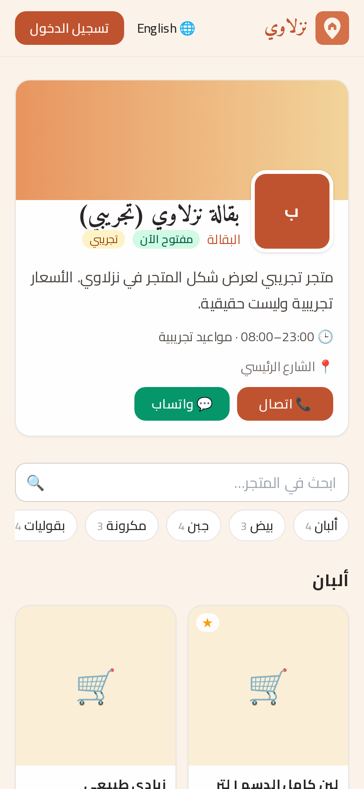
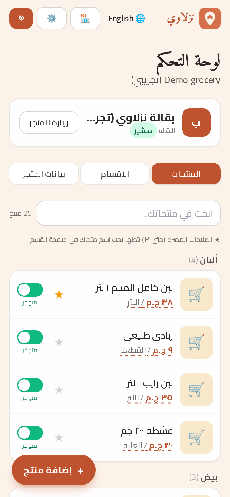
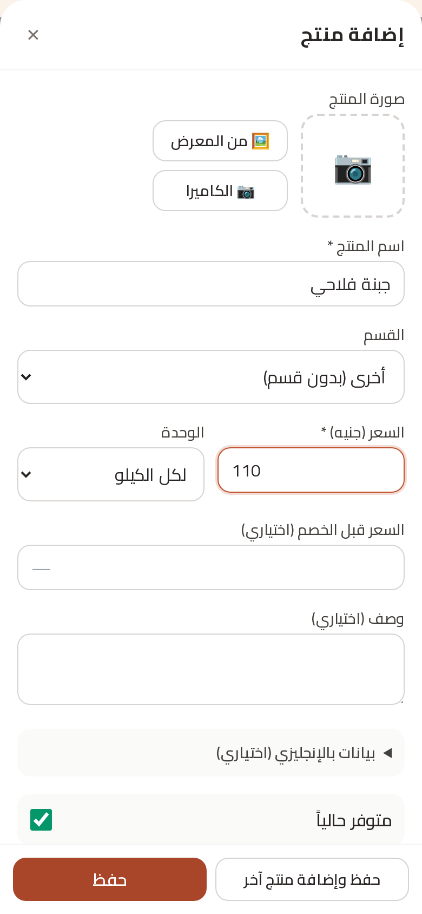
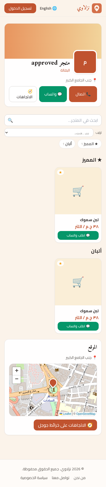
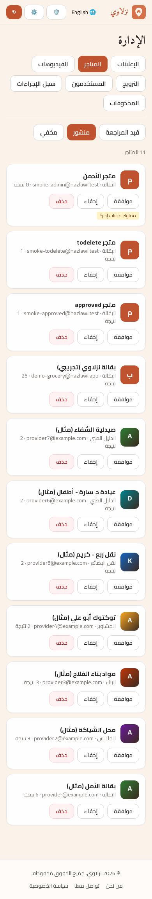

<div align="center">


# نزلاوي · Nazlawi

**كل اللي محتاجه في القرية… بضغطة واحدة**<br/>
*Everything you need in the village, one tap away.*

[🌐 Live website](https://nazlawi-bwfg-waslapp.vercel.app) · [📱 Download Android APK](https://github.com/mohammedemara48-code/nazlawi/releases/latest/download/nazlawi.apk) · [🚀 Deploy guide](docs/DEPLOY.md) · [🤖 Android guide](docs/ANDROID.md) · [🧱 Architecture & API](docs/ARCHITECTURE.md)

[](https://github.com/mohammedemara48-code/nazlawi/actions/workflows/ci.yml)     

</div>

---

## العربية

**نزلاوي** سوق خدمات للقرية: بقالة، ملابس، مواد بناء، مشاوير، نقل، دليل طبي (دكاترة، صيدليات، معامل)، مهن (كهربائي، سباك، نجار، محارة، جبس، وأي مهنة)، أسرة منتجة، وتجهيز مناسبات، مع تايم لاين لدعوات المناسبات — بالعربي والإنجليزي، على الويب وتطبيق أندرويد.

### المميزات
- 🏪 **متجر لكل تاجر**: أقسام ومنتجات بصورة وسعر ووحدة، عروض وسعر قبل الخصم، منتجات مميزة، ترتيب بالسحب، وطلب مباشر على واتساب.
- 🛠️ **أقسام جديدة**: مهن (كهربائي، سباك، نجار، محارة، جبس، أو اسم مهنة يكتبه مقدم الخدمة)، أسرة منتجة، وتجهيز مناسبات — بنفس تفاصيل المتجر (صورة، غلاف، خريطة، واتساب، أقسام ومنتجات وأسعار، ترويج).
- 💌 **دعوات المناسبات**: تايم لاين يقدر فيه الأهالي ينشروا صورة دعوة مع كلام، وأهل القرية يعجبوا ويعلّقوا، مع إبلاغ عن المحتوى وحذف نهائي من الإدارة.
- 👤 **صفحة شخصية** لكل مستخدم بصورته، تظهر جنب منشوراته وتعليقاته.
- 🔥 **تبويب الترويج**: التاجر يطلب ترويج لمتجره أو لمنتج لمدة محددة، والإدارة توافق، فيظهر في شريط "عروض مميزة".
- 🗺️ **الموقع بالخريطة** في كل مكان (المتجر، المنتج، العنوان) مع تحديد تلقائي بالـ GPS واتجاهات Google Maps.
- 🖼️ رفع صور وفيديو مباشر (Vercel Blob) مع ضغط الصور على الجهاز.
- 🛡️ **لوحة إدارة**: مراجعة المتاجر والفيديوهات والترويج، إدارة المستخدمين، سجل كامل للعمليات، و**حذف نهائي** للمتجر أو المنتج (كل البيانات والملفات) بعد تأكيد.
- 🔐 تسجيل وتأكيد بريد واستعادة كلمة مرور، صلاحيات (مقيم / مقدم خدمة / أدمن)، وحماية من الإغراق (rate limiting).
- 📱 PWA تعمل بدون إنترنت + تطبيق أندرويد (Capacitor) موقّع.

## English

**Nazlawi** is a bilingual (Arabic RTL / English) village services marketplace — web + Android.

### Features
- 🏪 **Merchant stores**: sections and priced products (photo, price, unit, old price, stock, featured, drag-reorder) published instantly, with one-tap WhatsApp ordering.
- 🛠️ **New sections**: Crafts (electrician, plumber, carpenter, plastering, gypsum, or a custom craft name), Productive families and Event preparation — with the same store details (photo, cover, map, WhatsApp, sections/products/prices, promotions).
- 💌 **Event invitations** timeline: residents post an image + caption; villagers like and comment; report button, owner delete, and permanent admin delete.
- 👤 **User profile page** with a profile photo shown on posts and comments.
- 🔥 **Promote tab**: merchants request time-boxed promotions for their store or a product; admins approve them into the "Featured offers" strip.
- 🗺️ **Map-based locations** everywhere (Leaflet + OpenStreetMap), GPS auto-centering, Google Maps directions.
- 🖼️ Direct photo/video uploads to Vercel Blob with client-side compression.
- 🛡️ **Admin panel**: store/video/promotion moderation, user management, audit log, and **permanent delete** of stores/products (rows + files) behind a confirmation dialog.
- 🔐 Email verification, password reset, role-based access, rate limiting.
- 📱 Offline-capable PWA and a signed Android app.

## Screenshots

| Home | Store | Merchant products |
|---|---|---|
|  |  |  |
| **Add product** | **Map location** | **Admin** |
|  |  |  |

More in [`docs/screenshots`](docs/screenshots).

## Tech stack
| Layer | Tech |
|---|---|
| Web | Next.js 15 (App Router, TypeScript), Tailwind CSS |
| Data | Prisma ORM · PostgreSQL |
| Files | Vercel Blob (direct uploads) |
| Maps | Leaflet + OpenStreetMap |
| Auth | JWT HttpOnly cookie (jose) + bcrypt, Zod validation |
| Mobile | Capacitor (Android), PWA service worker |
| Quality | Vitest (API/services), Playwright smoke suite, ESLint |
| Hosting | Vercel (+ Cron) |

## Getting started
```bash
npm install
cp .env.example .env        # fill in your own values
npx prisma migrate dev      # create the local database
npm run db:seed             # optional: fake demo data (flagged as examples)
npm run dev                 # http://localhost:3100
```

| Script | Purpose |
|---|---|
| `npm test` | Vitest suite against a local Postgres test DB |
| `npm run smoke` | Browser smoke suite (local DB only) |
| `npm run predeploy` | typecheck + lint + tests + smoke — **required before every push** (`git config core.hooksPath .githooks`) |
| `npm run worker` | Video processing worker |

## Environment variables
Names only — see [`.env.example`](.env.example) for descriptions. Never commit real values.

| Required | Optional |
|---|---|
| `DATABASE_URL`, `DIRECT_URL`, `AUTH_SECRET`, `APP_URL`, `STORAGE_DRIVER`, `BLOB_READ_WRITE_TOKEN`, `BLOB_ACCESS`, `CRON_SECRET` | `SMTP_HOST`, `SMTP_PORT`, `SMTP_SECURE`, `SMTP_USER`, `SMTP_PASS`, `MAIL_FROM`, `UPSTASH_REDIS_REST_URL`, `UPSTASH_REDIS_REST_TOKEN` (or `KV_REST_API_*` / `REDIS_URL`), `NEXT_PUBLIC_MAP_CENTER`, `NEXT_PUBLIC_PUSH_ENABLED`, `VIDEO_MAX_MB`, `VIDEO_MAX_SECONDS`, `FFMPEG_PATH`, `FFPROBE_PATH`, `DEMO_WHATSAPP` |

## Project layout
```
src/app/        pages ([lang]/…) and API routes (api/…)
src/lib/        services, validation, auth, storage, i18n
prisma/         schema, migrations, seed
mobile/         Capacitor Android app
scripts/        build, smoke suite, worker, screenshots
tests/          Vitest suites
docs/           deploy & Android guides, architecture, screenshots
```

## Roadmap
- [ ] Custom domain + production SMTP (verification / reset emails)
- [ ] Google Play release (signed AAB) and push notifications (Firebase)
- [ ] Order tracking and delivery requests inside the app
- [ ] Ratings and reviews for stores
- [ ] Online payment for promotions
- [ ] Merchant analytics (views, WhatsApp taps)
- [ ] Error monitoring and automated database backups

## Project docs
[CHANGELOG](CHANGELOG.md) · [Security policy](SECURITY.md) · [Contributing](CONTRIBUTING.md) · [Privacy](https://nazlawi-bwfg-waslapp.vercel.app/privacy) · [Terms](https://nazlawi-bwfg-waslapp.vercel.app/terms)

## License
Proprietary — all rights reserved © Nazlawi. See [LICENSE](LICENSE).
